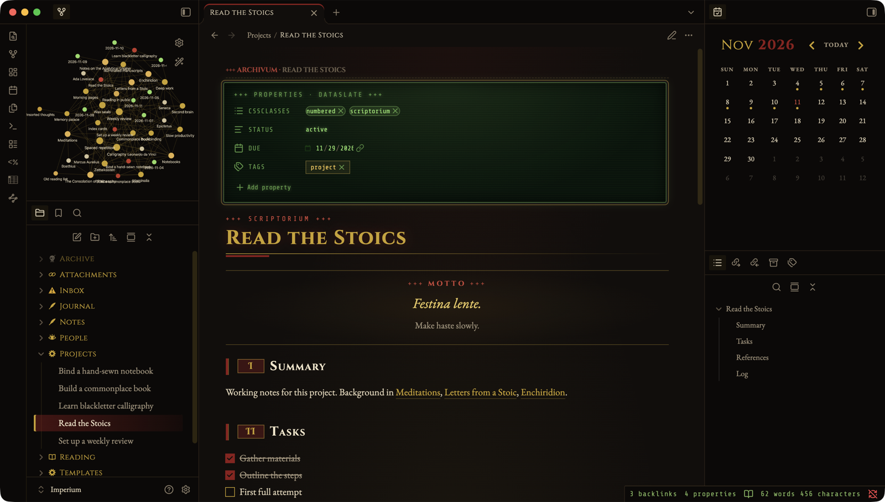
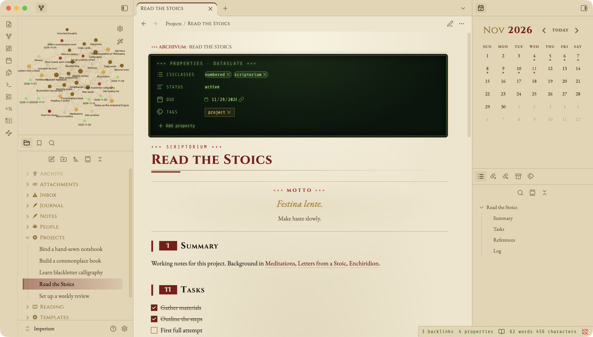
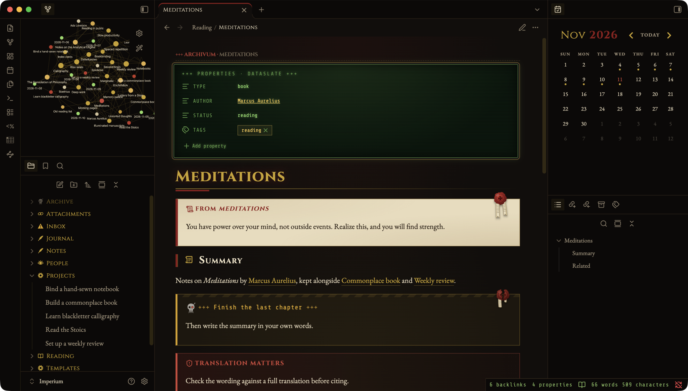
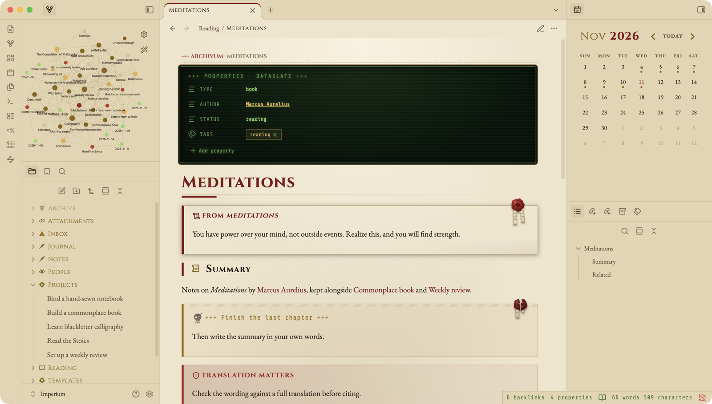

# Imperium

A grimdark gothic theme for [Obsidian](https://obsidian.md): blackened iron, gilded brass, crimson wax and old vellum.



## Features

- **Two modes.** *Night* (dark) and *Parchment* (light).
- **Gothic type throughout.** Cinzel and UnifrakturMaguntia for headings, EB Garamond for body text, Share Tech Mono for code and readouts.
- **Dataslate properties.** The Properties panel becomes a green terminal readout ("+++ Properties · dataslate +++") with scanlines and a bronze frame, in both modes. Obsidian's own show/hide setting for properties still applies.
- **Ornamental dividers.** `---` becomes a gilded rule with a centred cross.
- **Record-style inline title.** The inline title becomes a small record header, so a note that opens with `# Title` doesn't show its title twice.
- **Vellum slabs.** `[!quote]` and `[!vellum]` callouts are set on vellum with a wax seal.
- **Wax seals.** Seals also hang from title cards and mark `[!warning]` callouts.
- **Hazard to-dos.** `[!todo]` callouts get hazard-striped borders.
- **Dataview readouts.** Dataview lists and tables are styled as auto-indexed readouts in a monospaced terminal face.
- **Sidebar icons** for common folder names (see below).

## Opt-in extras

### Numbered sections

Add `numbered` to a note's `cssclasses`, and every `##` heading gets a Roman-numeral badge (I, II, III…):

```yaml
---
cssclasses:
  - numbered
---
```

### H1 kickers

Add one of `scriptorium`, `lexicon`, `codex`, `archivum`, `chronicle` or `compendium` to `cssclasses`, and a crimson `+++ Label +++` line appears above the note's `#` heading:

```yaml
---
cssclasses:
  - scriptorium
---
# Field Journal
```

### Dashboard pages

`cssclasses: imp-home` hides the inline title and properties (edit them in Source mode) and widens the page, which suits a home or index note.

### Callouts

| Callout | Looks like |
| --- | --- |
| `[!title-card]` | Framed title card with hanging wax seals (no title bar) |
| `[!thought]` | Centred epigraph between gilded rules; first line large and italic |
| `[!legend]` | Panel with a crimson edge, for keys and legends |
| `[!card]` | Gilded side rule, no icon |
| `[!vellum]` | Vellum slab with a wax seal (same as `[!quote]`) |

A title card takes optional spans for its lines:

```markdown
> [!title-card]
> <span class="imp-kicker">Any vault · any subject</span>
> <span class="imp-title">Field Journal</span>
> <span class="imp-subtitle">Notes and references</span>
> <span class="imp-byline"><b>By:</b> Your name</span>
```

In a `[!legend]`, `<span class="imp-red">`, `imp-gold` and `imp-grey` give bold coloured labels.

### Folder and heading icons

Folders get icons when they're named one of these, at the vault root or nested, in any letter case:

| Icon | Folder names |
| --- | --- |
| Hazard | Inbox, To Sort |
| Cog | Templates, Projects, Scripts, Meta |
| Quill | Notes, Journal, Daily, Daily Notes, Drafts, Writing |
| Book | Literature, Books, Reading, Library, Wiki |
| Scroll | References, Resources, Sources |
| Chain | Attachments, Assets, Media, Files |
| Eye | People, Contacts |
| Scales | Cases |
| Skull | Archive, Archives (also dimmed until hovered) |

`#` and `##` headings named Tasks, To Do, Summary, References, Sources, Ideas, Log, Related or Literature also get an icon.

Numbered sections, vellum seals and Dataview readouts are styled in Reading View. Live Preview gets the palette, type, callouts and headings.

## Screenshots

| Dark (Night) | Light (Parchment) |
| --- | --- |
|  |  |
|  |  |
|  |  |

## Installation

**From Obsidian:** Settings → Appearance → Themes → Manage → search for **Imperium** → Install and use.

**Manually:** copy `theme.css` and `manifest.json` into `<your vault>/.obsidian/themes/Imperium/`, then pick Imperium under Settings → Appearance.

Imperium needs Obsidian 1.8 or later.

## Privacy and network access

Imperium makes **no network requests**. All fonts are embedded in `theme.css` as base64 WOFF2, and all icons are inline SVG data URIs. The only `http` strings in the file are SVG `xmlns` namespace identifiers, which are never fetched.

## Font credits

Imperium embeds these fonts. Each is licensed under the [SIL Open Font License, Version 1.1](https://openfontlicense.org):

| Font | Designer |
| --- | --- |
| Cinzel | Natanael Gama |
| Cinzel Decorative | Natanael Gama |
| UnifrakturMaguntia | J. "Mach" Wust |
| EB Garamond | Georg Duffner, Octavio Pardo |
| Share Tech Mono | Carrois Apostrophe |

The OFL allows these fonts to be bundled and redistributed with software as long as they aren't sold on their own. The fonts stay under the OFL; the MIT license below doesn't cover them.

## License

Theme code: [MIT](LICENSE) © 2026 Leo Lloyd A. Catalan.
Embedded fonts: SIL Open Font License 1.1 (see above).
